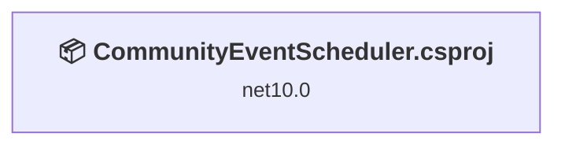
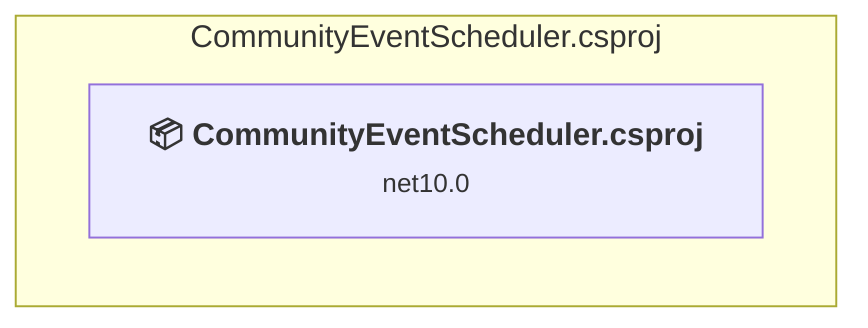

# Projects and dependencies analysis

This document provides a comprehensive overview of the projects and their dependencies in the context of upgrading to .NETCoreApp,Version=v11.0.

## Table of Contents

- [Executive Summary](#executive-Summary)
  - [Highlevel Metrics](#highlevel-metrics)
  - [Projects Compatibility](#projects-compatibility)
  - [Package Compatibility](#package-compatibility)
  - [API Compatibility](#api-compatibility)
  - [Binding Redirect Configuration](#binding-redirect-configuration)
- [Aggregate NuGet packages details](#aggregate-nuget-packages-details)
- [Top API Migration Challenges](#top-api-migration-challenges)
  - [Technologies and Features](#technologies-and-features)
  - [Most Frequent API Issues](#most-frequent-api-issues)
- [Projects Relationship Graph](#projects-relationship-graph)
- [Project Details](#project-details)

  - [CommunityEvenScheduler\CommunityEventScheduler.csproj](#communityevenschedulercommunityeventschedulercsproj)

## Executive Summary

### Highlevel Metrics

| Metric | Count | Status |
| :--- | :---: | :--- |
| Total Projects | 1 | All require upgrade |
| Total NuGet Packages | 52 | 6 need upgrade |
| Total Code Files | 116 |  |
| Total Code Files with Incidents | 3 |  |
| Total Lines of Code | 9066 |  |
| Total Number of Issues | 19 |  |
| Estimated LOC to modify | 12+ | at least 0.1% of codebase |

### Projects Compatibility

| Project | Target Framework | Difficulty | Package Issues | API Issues | Binding Issues | Est. LOC Impact | Description |
| :--- | :---: | :---: | :---: | :---: | :---: | :---: | :--- |
| [CommunityEvenScheduler\CommunityEventScheduler.csproj](#communityevenschedulercommunityeventschedulercsproj) | net10.0 | 🟢 Low | 6 | 12 | 0 | 12+ | AspNetCore, Sdk Style = True |

### Package Compatibility

| Status | Count | Percentage |
| :--- | :---: | :---: |
| ✅ Compatible | 46 | 88.5% |
| ⚠️ Incompatible | 0 | 0.0% |
| 🔄 Upgrade Recommended | 6 | 11.5% |
| ***Total NuGet Packages*** | ***52*** | ***100%*** |

### API Compatibility

| Category | Count | Impact |
| :--- | :---: | :--- |
| 🔴 Binary Incompatible | 0 | High - Require code changes |
| 🟡 Source Incompatible | 11 | Medium - Needs re-compilation and potential conflicting API error fixing |
| 🔵 Behavioral change | 1 | Low - Behavioral changes that may require testing at runtime |
| ✅ Compatible | 32461 |  |
| ***Total APIs Analyzed*** | ***32473*** |  |

## Aggregate NuGet packages details

| Package | Current Version | Suggested Version | Projects | Description |
| :--- | :---: | :---: | :--- | :--- |
| Azure.Core | 1.50.0 |  | [CommunityEventScheduler.csproj](#communityevenschedulercommunityeventschedulercsproj) | ✅Compatible |
| Azure.Identity | 1.17.1 |  | [CommunityEventScheduler.csproj](#communityevenschedulercommunityeventschedulercsproj) | ✅Compatible |
| Humanizer.Core | 2.14.1 |  | [CommunityEventScheduler.csproj](#communityevenschedulercommunityeventschedulercsproj) | ✅Compatible |
| Microsoft.AspNetCore.Diagnostics.EntityFrameworkCore | 10.0.12 | 10.0.15 | [CommunityEventScheduler.csproj](#communityevenschedulercommunityeventschedulercsproj) | NuGet package upgrade is recommended |
| Microsoft.AspNetCore.Identity.EntityFrameworkCore | 10.0.12 | 10.0.15 | [CommunityEventScheduler.csproj](#communityevenschedulercommunityeventschedulercsproj) | NuGet package upgrade is recommended |
| Microsoft.AspNetCore.Identity.UI | 10.0.12 | 10.0.15 | [CommunityEventScheduler.csproj](#communityevenschedulercommunityeventschedulercsproj) | NuGet package upgrade is recommended |
| Microsoft.Bcl.AsyncInterfaces | 8.0.0 |  | [CommunityEventScheduler.csproj](#communityevenschedulercommunityeventschedulercsproj) | ✅Compatible |
| Microsoft.Build.Framework | 18.0.2 |  | [CommunityEventScheduler.csproj](#communityevenschedulercommunityeventschedulercsproj) | ✅Compatible |
| Microsoft.CodeAnalysis.Analyzers | 3.11.0 |  | [CommunityEventScheduler.csproj](#communityevenschedulercommunityeventschedulercsproj) | ✅Compatible |
| Microsoft.CodeAnalysis.Common | 5.0.0 |  | [CommunityEventScheduler.csproj](#communityevenschedulercommunityeventschedulercsproj) | ✅Compatible |
| Microsoft.CodeAnalysis.CSharp | 5.0.0 |  | [CommunityEventScheduler.csproj](#communityevenschedulercommunityeventschedulercsproj) | ✅Compatible |
| Microsoft.CodeAnalysis.CSharp.Workspaces | 5.0.0 |  | [CommunityEventScheduler.csproj](#communityevenschedulercommunityeventschedulercsproj) | ✅Compatible |
| Microsoft.CodeAnalysis.Workspaces.Common | 5.0.0 |  | [CommunityEventScheduler.csproj](#communityevenschedulercommunityeventschedulercsproj) | ✅Compatible |
| Microsoft.CodeAnalysis.Workspaces.MSBuild | 5.0.0 |  | [CommunityEventScheduler.csproj](#communityevenschedulercommunityeventschedulercsproj) | ✅Compatible |
| Microsoft.Data.SqlClient | 6.1.6 |  | [CommunityEventScheduler.csproj](#communityevenschedulercommunityeventschedulercsproj) | ✅Compatible |
| Microsoft.Data.SqlClient.SNI.runtime | 6.0.2 |  | [CommunityEventScheduler.csproj](#communityevenschedulercommunityeventschedulercsproj) | ✅Compatible |
| Microsoft.EntityFrameworkCore | 10.0.12 |  | [CommunityEventScheduler.csproj](#communityevenschedulercommunityeventschedulercsproj) | ✅Compatible |
| Microsoft.EntityFrameworkCore.Abstractions | 10.0.12 |  | [CommunityEventScheduler.csproj](#communityevenschedulercommunityeventschedulercsproj) | ✅Compatible |
| Microsoft.EntityFrameworkCore.Analyzers | 10.0.12 |  | [CommunityEventScheduler.csproj](#communityevenschedulercommunityeventschedulercsproj) | ✅Compatible |
| Microsoft.EntityFrameworkCore.Design | 10.0.12 | 10.0.15 | [CommunityEventScheduler.csproj](#communityevenschedulercommunityeventschedulercsproj) | NuGet package upgrade is recommended |
| Microsoft.EntityFrameworkCore.Relational | 10.0.12 |  | [CommunityEventScheduler.csproj](#communityevenschedulercommunityeventschedulercsproj) | ✅Compatible |
| Microsoft.EntityFrameworkCore.SqlServer | 10.0.12 | 10.0.15 | [CommunityEventScheduler.csproj](#communityevenschedulercommunityeventschedulercsproj) | NuGet package upgrade is recommended |
| Microsoft.EntityFrameworkCore.Tools | 10.0.12 | 10.0.15 | [CommunityEventScheduler.csproj](#communityevenschedulercommunityeventschedulercsproj) | NuGet package upgrade is recommended |
| Microsoft.Extensions.DependencyModel | 10.0.12 |  | [CommunityEventScheduler.csproj](#communityevenschedulercommunityeventschedulercsproj) | ✅Compatible |
| Microsoft.Extensions.FileProviders.Embedded | 10.0.12 |  | [CommunityEventScheduler.csproj](#communityevenschedulercommunityeventschedulercsproj) | ✅Compatible |
| Microsoft.Identity.Client | 4.84.2 |  | [CommunityEventScheduler.csproj](#communityevenschedulercommunityeventschedulercsproj) | ✅Compatible |
| Microsoft.Identity.Client.Broker | 4.84.2 |  | [CommunityEventScheduler.csproj](#communityevenschedulercommunityeventschedulercsproj) | ✅Compatible |
| Microsoft.Identity.Client.Extensions.Msal | 4.78.0 |  | [CommunityEventScheduler.csproj](#communityevenschedulercommunityeventschedulercsproj) | ✅Compatible |
| Microsoft.Identity.Client.NativeInterop | 0.20.6 |  | [CommunityEventScheduler.csproj](#communityevenschedulercommunityeventschedulercsproj) | ✅Compatible |
| Microsoft.IdentityModel.Abstractions | 8.14.0 |  | [CommunityEventScheduler.csproj](#communityevenschedulercommunityeventschedulercsproj) | ✅Compatible |
| Microsoft.IdentityModel.JsonWebTokens | 7.7.1 |  | [CommunityEventScheduler.csproj](#communityevenschedulercommunityeventschedulercsproj) | ✅Compatible |
| Microsoft.IdentityModel.Logging | 7.7.1 |  | [CommunityEventScheduler.csproj](#communityevenschedulercommunityeventschedulercsproj) | ✅Compatible |
| Microsoft.IdentityModel.Protocols | 7.7.1 |  | [CommunityEventScheduler.csproj](#communityevenschedulercommunityeventschedulercsproj) | ✅Compatible |
| Microsoft.IdentityModel.Protocols.OpenIdConnect | 7.7.1 |  | [CommunityEventScheduler.csproj](#communityevenschedulercommunityeventschedulercsproj) | ✅Compatible |
| Microsoft.IdentityModel.Tokens | 7.7.1 |  | [CommunityEventScheduler.csproj](#communityevenschedulercommunityeventschedulercsproj) | ✅Compatible |
| Microsoft.SqlServer.Server | 1.0.0 |  | [CommunityEventScheduler.csproj](#communityevenschedulercommunityeventschedulercsproj) | ✅Compatible |
| Microsoft.VisualStudio.SolutionPersistence | 1.0.52 |  | [CommunityEventScheduler.csproj](#communityevenschedulercommunityeventschedulercsproj) | ✅Compatible |
| Mono.TextTemplating | 3.0.0 |  | [CommunityEventScheduler.csproj](#communityevenschedulercommunityeventschedulercsproj) | ✅Compatible |
| Newtonsoft.Json | 13.0.4 |  | [CommunityEventScheduler.csproj](#communityevenschedulercommunityeventschedulercsproj) | ✅Compatible |
| System.ClientModel | 1.8.0 |  | [CommunityEventScheduler.csproj](#communityevenschedulercommunityeventschedulercsproj) | ✅Compatible |
| System.CodeDom | 6.0.0 |  | [CommunityEventScheduler.csproj](#communityevenschedulercommunityeventschedulercsproj) | ✅Compatible |
| System.Composition | 9.0.0 |  | [CommunityEventScheduler.csproj](#communityevenschedulercommunityeventschedulercsproj) | ✅Compatible |
| System.Composition.AttributedModel | 9.0.0 |  | [CommunityEventScheduler.csproj](#communityevenschedulercommunityeventschedulercsproj) | ✅Compatible |
| System.Composition.Convention | 9.0.0 |  | [CommunityEventScheduler.csproj](#communityevenschedulercommunityeventschedulercsproj) | ✅Compatible |
| System.Composition.Hosting | 9.0.0 |  | [CommunityEventScheduler.csproj](#communityevenschedulercommunityeventschedulercsproj) | ✅Compatible |
| System.Composition.Runtime | 9.0.0 |  | [CommunityEventScheduler.csproj](#communityevenschedulercommunityeventschedulercsproj) | ✅Compatible |
| System.Composition.TypedParts | 9.0.0 |  | [CommunityEventScheduler.csproj](#communityevenschedulercommunityeventschedulercsproj) | ✅Compatible |
| System.Configuration.ConfigurationManager | 9.0.11 |  | [CommunityEventScheduler.csproj](#communityevenschedulercommunityeventschedulercsproj) | ✅Compatible |
| System.IdentityModel.Tokens.Jwt | 7.7.1 |  | [CommunityEventScheduler.csproj](#communityevenschedulercommunityeventschedulercsproj) | ✅Compatible |
| System.Memory.Data | 8.0.1 |  | [CommunityEventScheduler.csproj](#communityevenschedulercommunityeventschedulercsproj) | ✅Compatible |
| System.Security.Cryptography.Pkcs | 9.0.11 |  | [CommunityEventScheduler.csproj](#communityevenschedulercommunityeventschedulercsproj) | ✅Compatible |
| System.Security.Cryptography.ProtectedData | 9.0.11 |  | [CommunityEventScheduler.csproj](#communityevenschedulercommunityeventschedulercsproj) | ✅Compatible |

## Top API Migration Challenges

### Technologies and Features

| Technology | Issues | Percentage | Migration Path |
| :--- | :---: | :---: | :--- |

### Most Frequent API Issues

| API | Count | Percentage | Category |
| :--- | :---: | :---: | :--- |
| M:Microsoft.AspNetCore.Identity.EntityFrameworkCore.IdentityDbContext.#ctor(Microsoft.EntityFrameworkCore.DbContextOptions) | 2 | 16.7% | Source Incompatible |
| T:Microsoft.AspNetCore.Identity.EntityFrameworkCore.IdentityDbContext | 1 | 8.3% | Source Incompatible |
| M:Microsoft.AspNetCore.Builder.ExceptionHandlerExtensions.UseExceptionHandler(Microsoft.AspNetCore.Builder.IApplicationBuilder,System.String) | 1 | 8.3% | Behavioral Change |
| T:Microsoft.AspNetCore.Builder.MigrationsEndPointExtensions | 1 | 8.3% | Source Incompatible |
| M:Microsoft.AspNetCore.Builder.MigrationsEndPointExtensions.UseMigrationsEndPoint(Microsoft.AspNetCore.Builder.IApplicationBuilder) | 1 | 8.3% | Source Incompatible |
| T:Microsoft.Extensions.DependencyInjection.IdentityServiceCollectionUIExtensions | 1 | 8.3% | Source Incompatible |
| M:Microsoft.Extensions.DependencyInjection.IdentityServiceCollectionUIExtensions.AddDefaultIdentity''1(Microsoft.Extensions.DependencyInjection.IServiceCollection,System.Action{Microsoft.AspNetCore.Identity.IdentityOptions}) | 1 | 8.3% | Source Incompatible |
| T:Microsoft.Extensions.DependencyInjection.IdentityEntityFrameworkBuilderExtensions | 1 | 8.3% | Source Incompatible |
| M:Microsoft.Extensions.DependencyInjection.IdentityEntityFrameworkBuilderExtensions.AddEntityFrameworkStores''1(Microsoft.AspNetCore.Identity.IdentityBuilder) | 1 | 8.3% | Source Incompatible |
| T:Microsoft.Extensions.DependencyInjection.DatabaseDeveloperPageExceptionFilterServiceExtensions | 1 | 8.3% | Source Incompatible |
| M:Microsoft.Extensions.DependencyInjection.DatabaseDeveloperPageExceptionFilterServiceExtensions.AddDatabaseDeveloperPageExceptionFilter(Microsoft.Extensions.DependencyInjection.IServiceCollection) | 1 | 8.3% | Source Incompatible |

## Projects Relationship Graph

Legend:
📦 SDK-style project
⚙️ Classic project

## Project Details

### CommunityEvenScheduler\CommunityEventScheduler.csproj

#### Project Info

- **Current Target Framework:** net10.0
- **Proposed Target Framework:** net11.0
- **SDK-style**: True
- **Project Kind:** AspNetCore
- **Dependencies**: 0
- **Dependants**: 0
- **Number of Files**: 122
- **Number of Files with Incidents**: 3
- **Lines of Code**: 9066
- **Estimated LOC to modify**: 12+ (at least 0.1% of the project)

#### Dependency Graph

Legend:
📦 SDK-style project
⚙️ Classic project

### API Compatibility

| Category | Count | Impact |
| :--- | :---: | :--- |
| 🔴 Binary Incompatible | 0 | High - Require code changes |
| 🟡 Source Incompatible | 11 | Medium - Needs re-compilation and potential conflicting API error fixing |
| 🔵 Behavioral change | 1 | Low - Behavioral changes that may require testing at runtime |
| ✅ Compatible | 32461 |  |
| ***Total APIs Analyzed*** | ***32473*** |  |

